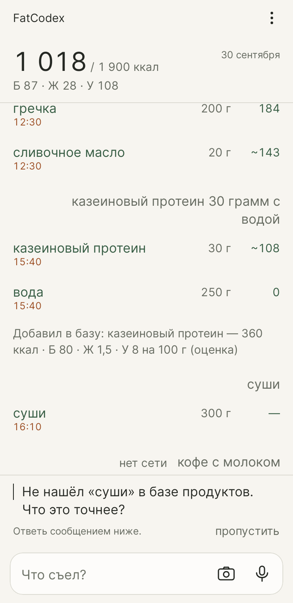
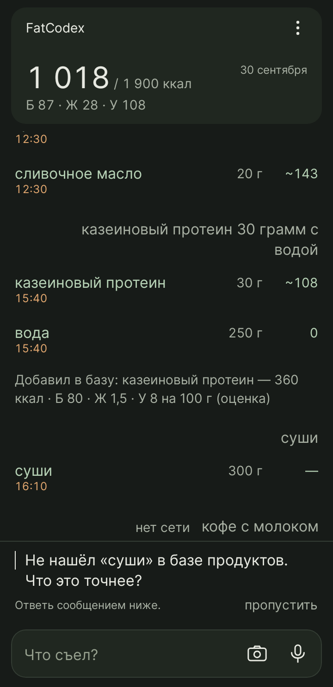
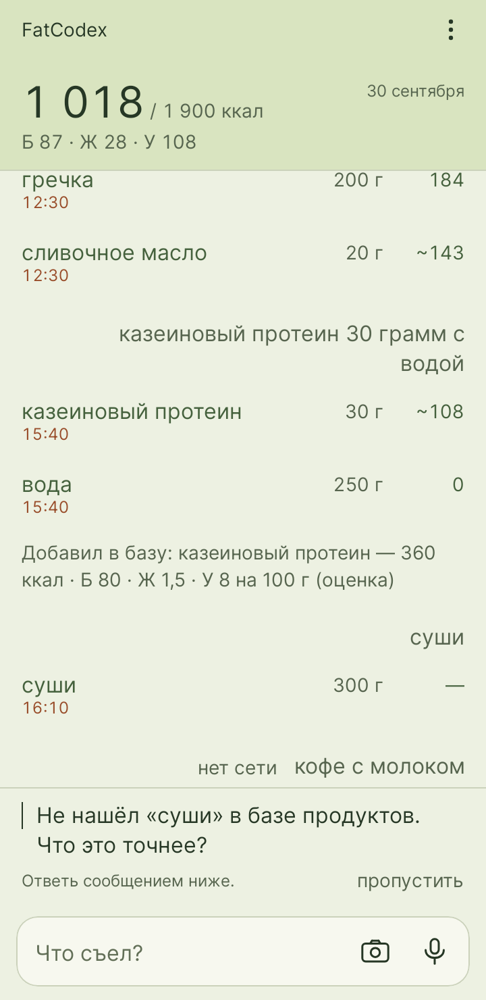

# FatCodex

 

[English](README.md) · **Русский**

Дневник питания в одном поле ввода.

Напиши, что съел, скажи вслух или сфотографируй тарелку. FatCodex сам поймёт, что это и сколько, посчитает калории, белки, жиры и углеводы и ведёт дневник. Никаких форм и поиска по списку продуктов.

## Как это выглядит

- `овсянка 60 г, банан` → две записи с калориями и КБЖУ
- `масла было меньше`, `это была половина`, `убери хлеб` → правят то, что уже записано
- `вес 82.4` → записывает вес и показывает тренд
- первый запуск → пять коротких вопросов о тебе (пол, возраст, рост, вес, активность) и оценка, сколько ккал в день ты тратишь
- `борщ` → одна строка с галочкой: раскрой её, увидишь ингредиенты, и один можно поправить (больше мяса, без сметаны)
- часы и умные весы (через Health Connect, одной кнопкой) → сон, шаги, тренировки и утренний вес появляются сами
- фото тарелки → приложение распознаёт еду и оставляет её маленькое фото в чате; фото чека или меню (с камеры или из галереи) → читает позиции по строкам

## Темы

В **Настройки → Тема** доступны **Бумага**, **Уголь**, **Матча** и **Как в системе**. Выбор применяется сразу и сохраняется.

| Бумага | Уголь | Матча |
| --- | --- | --- |
|  |  |  |

## Почему цифрам можно верить

ИИ только называет продукты и граммы. Калории берутся из твоей собственной базы продуктов, которую ведёт сам ИИ: он ищет продукт в интернете, показывает тебе значения с источником, и в базу попадает только то, что ты подтвердил. «Похожих» продуктов из встроенных таблиц нет. Примерные оценки помечены знаком `~`, а если что-то непонятно, приложение задаёт один короткий вопрос, а не гадает. Если ИИ недоступен, сообщение остаётся в чате с красной кнопкой **Повторить**, и ничего не записывается наугад.

Цель на день не вводится, а считается: по твоим ответам приложение находит, сколько ты тратишь в день, а ты добавляешь корректировку (минус, чтобы худеть, плюс, чтобы набирать).

## Твои данные

Аккаунт и сервер не нужны: дневник хранится на телефоне. Чтобы читать то, что ты написал или сфотографировал, приложение использует DeepSeek с твоим собственным ключом, поэтому нужен интернет. Туда уходит только то, что ты написал или сфотографировал.

Приложение записывает, но отчётов не пишет. Чтобы разобрать историю, выгрузи её (Настройки → История → экспорт) в Markdown, JSON или CSV и отдай файл любой модели или таблице.

## Статус

Ранний личный проект, бесплатный и некоммерческий. В Google Play его пока нет, на настоящем телефоне он ещё не проверялся, так что возможны шероховатости.

## Установка

Скачай APK из [последнего релиза](https://github.com/MAppleDm/FatCodex/releases/latest) и открой его на телефоне с Android 8.0 или новее. Для работы нужен свой ключ DeepSeek.

Сборка из исходников и подробности: [docs/details.ru.md](docs/details.ru.md).

Следующие версии: **Настройки → О приложении → Обновления**. Приложение проверит GitHub, покажет описание релиза и скачает APK; установку подтвердит Android. Загрузка продолжится после закрытия приложения, а повреждённый файл или APK с несовместимой подписью не установится.

## Участие и версии

Ошибки и предложения: [Issues](https://github.com/MAppleDm/FatCodex/issues). Правила участия: [CONTRIBUTING.md](CONTRIBUTING.md).

Релизы имеют версии `vX.X.X`: [история изменений](CHANGELOG.md), [публикация релизов](RELEASING.md).

## Лицензия

MIT, см. [LICENSE](LICENSE).
